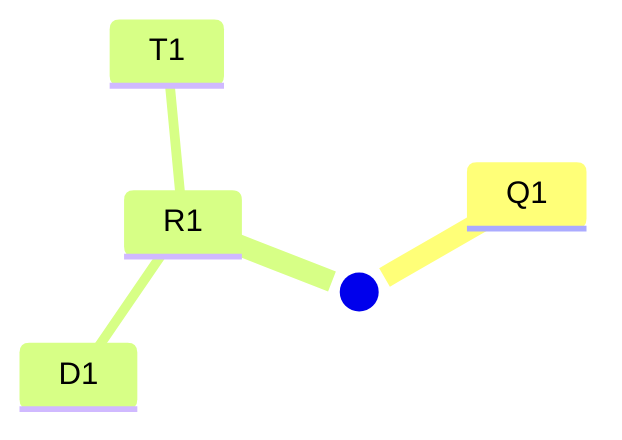

# Mind map

`MINDMAP.md` at the project root is the one map of the project. Update it after each substantive answer. Never put a person's name or health detail in it; use roles.

## Layout

```markdown
# Mind map: <project>
Last updated: <YYYY-MM-DD>

## Hierarchy
- **Goal:** <Amanda's goal in her words>
  - **Q1** <open question> — open | answered (<card id or source>)
  - **R1** <rule> — <citation> — <card id> — verified | unverified
    - **D1** <decision Amanda or the owner made, with date and decision maker>
    - **T1** <follow-up task> — <who> — <due date> — open | done
  - **S1** <source ingested> — knowledge/sources/<slug>.md

## Diagram


## Counts
| Kind | In hierarchy | In diagram |
|---|---|---|
| Questions | n | n |
| Rules | n | n |
| Decisions | n | n |
| Tasks | n | n |
```

## Rules

1. Every node appears once in the hierarchy and once in the diagram; the counts match. A mismatch is an error to fix before answering.
2. Node IDs are stable: never renumber. Close a node by changing its status, never by deleting it.
3. A rule node cites its card id or source. An unverified rule says "unverified".
4. Diagram labels stay under 6 words; detail lives in the hierarchy.
5. When asked "where are we", answer from the map: open questions, open tasks with due dates, and unverified rules.

`templates/MINDMAP.hinshitsu.md` is the user's fuller audit-run variant (criteria, work units, findings); use it for software or audit runs instead.
